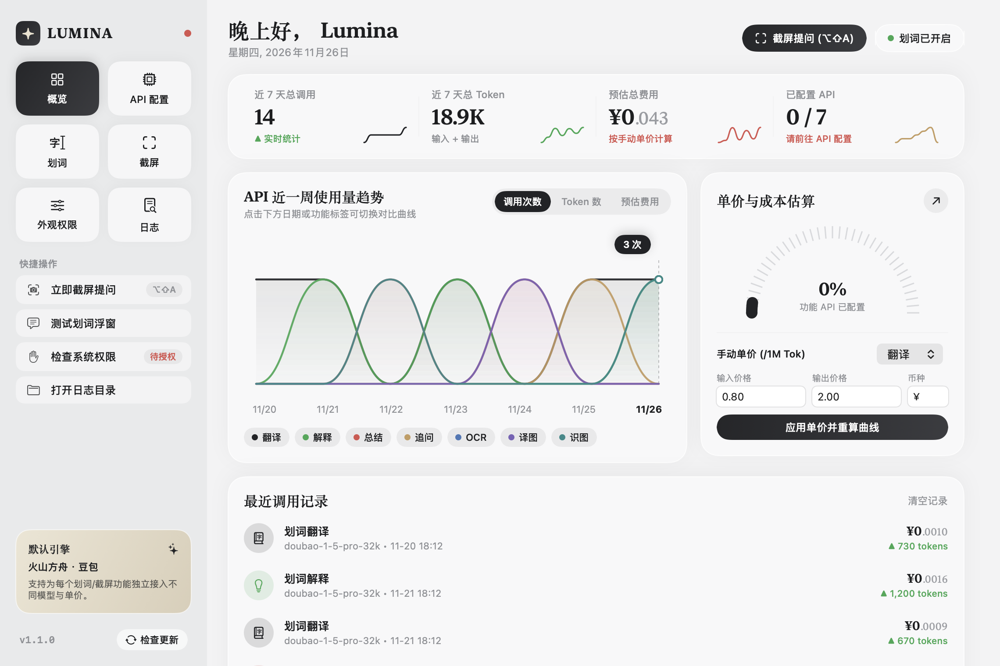

<div align="center">
  
  <h1>LuminaAI</h1>
  <p><strong>A featherweight, 100% native macOS AI assistant for global text selection & multimodal screenshot Q&A.</strong></p>

  <p>
    
    
    
    
    
  </p>

  <p>
    <a href="#features">English</a> &nbsp;·&nbsp;
    <a href="#中文介绍">中文介绍</a> &nbsp;·&nbsp;
    <a href="#quick-start">Quick Start</a> &nbsp;·&nbsp;
    <a href="#privacy--security">Privacy</a>
  </p>
</div>

---

<div align="center">
  
  <br />
  <sub><em>LuminaAI Editorial Bento Dashboard — 7-day multi-API usage trends, relative cost curves, and manual pricing estimator.</em></sub>
</div>

<br />

## Why LuminaAI?

Most desktop AI assistants bundle Electron / Chromium runtimes that consume **400–800 MB of RAM** just to sit in your menu bar. **LuminaAI** is built from scratch with pure **SwiftUI + AppKit + Vision + ScreenCaptureKit**:

| Metric | LuminaAI | Typical Electron AI Apps |
| :--- | :--- | :--- |
| **App Binary Size** | **~2.6 MB** (zero third-party dependencies) | 150 – 350 MB |
| **Idle Background RAM** | **~20 – 30 MB** (releases dashboard UI on close) | 400 – 800 MB |
| **Idle CPU Usage** | **~0.0%** (zero drag polling, Carbon hotkeys) | 1% – 5% |
| **Native Capabilities** | Offline Apple Vision OCR, Native `NSPanel`, `SMAppService` | Web-wrapped |

---

## Features

### 1. Global Text Selection Capsule & Smart Copy
- Select text in any macOS app to summon a sleek floating capsule near your cursor: **Copy**, **Translate**, **Explain**, **Summarize**, and **Follow-up**.
- **Smart / Force Copy**: Tries native `⌘C` first; if a webpage blocks copying via JS `oncopy` / `preventDefault()`, automatically falls back to macOS Accessibility tree extraction to copy cleanly without opening any popup.
- **Customizable Capsule**: Toggle individual buttons on/off and reorder them freely in Settings with a live preview.
- **Rich Floating Reply Window**: Native chromeless macOS `NSPanel` with smooth 4-edge/4-corner resizing, SSE streaming output, **Markdown rich-text & code-block rendering**, collapsible **Thinking / Reasoning** process (collapsed by default), **source/target language switcher**, click-outside auto-dismiss, and a **Pin** toggle.

### 2. Global Hotkey Multimodal Screenshot Q&A
- Record any custom global shortcut (single F-key or any multi-modifier combo like `⌥⇧A`, `⌘⌥⇧S`).
- Smooth darkened vignette overlay with a crisp black crosshair cursor. After releasing the mouse, **freely drag to reposition** or **resize any of the 4 edges & 4 corners** of the captured region.
- Floating action bar supports:
  - **Copy Screenshot** to clipboard with unobtrusive HUD toast
  - **Extract Text (OCR)** powered by on-device Apple **Vision** (Simplified/Traditional Chinese & English, fast & free) with automatic multimodal AI fallback
  - **AI Translate Image** with auto-detect source & target language picker
  - **Multimodal AI Ask** with image thumbnail & quick prompt chips

### 3. Per-Feature API Routing, Preset Prompts & Thinking Control
- Configure **independent OpenAI-compatible APIs** for every single feature (defaults to **Volcengine Ark / Doubao**, with one-click presets for **OpenAI** and **DeepSeek**).
- **One-click Copy API Config** from one feature to any specific feature, all text features, or all 7 features.
- View, customize, or reset **Preset System Prompts** per feature.
- Toggle **Thinking / Reasoning mode** with selectable effort (**Low / Medium / High**), compatible with both Volcengine Ark `thinking` and OpenAI `reasoning_effort`.

### 4. Editorial 7-Day Usage Analytics & Manual Pricing
- Multi-series smooth Bezier spline curves tracking **Calls**, **Tokens**, and **Estimated Cost** across the past 7 days.
- **Relative proportional cost scaling** so even tiny fractions-of-a-cent token costs display clear daily trends and percentage shares.
- Manually enter Input/Output token prices per 1M tokens and currency (`¥` / `$`) to recalculate costs in real time.

### 5. Permission-Preserving Updates, Launch at Login & Safe Logging
- **Dock / Menu Bar Toggle** + optional **Launch at Login** (`SMAppService` with `LaunchAgent` fallback).
- **Persistent Local Code Signing** (`setup_local_cert.sh`): sign builds with a dedicated certificate in your login keychain so macOS Accessibility & Screen Recording permissions stay intact across rebuilds and GitHub auto-updates.
- **Built-in GitHub Auto-Updater**: check for new releases from the bottom-left sidebar, download, re-sign locally, and relaunch automatically.
- **Rate-Limited Background Logs**: writes to `~/Library/Logs/LuminaAI/lumina.log` with configurable retention (`1 Day / 1 Week / 1 Month`), max line cap (`200–5000 lines`), and 3-second duplicate suppression.

---

## Quick Start

> **Requirements**: Apple Silicon Mac (`arm64`), macOS 14.0+, and **Xcode Command Line Tools** (`xcode-select --install`). Full Xcode.app is **not** required.

```bash
git clone https://github.com/oswin-creator/LuminaAI.git
cd LuminaAI

# 1. (Recommended) Create a persistent local signing certificate once so macOS preserves permissions across updates
chmod +x setup_local_cert.sh && ./setup_local_cert.sh

# 2. Compile & bundle LuminaAI.app
chmod +x build.sh && ./build.sh
```

The compiled `LuminaAI.app` will be generated in the parent directory. Double-click to launch (or drag into `/Applications`).

---

## Privacy & Security

- **100% Local Storage**: Your API keys, prompts, usage history, and logs are stored strictly on your Mac in `~/Library/Application Support/LuminaAI/` and `~/Library/Logs/LuminaAI/`.
- **Direct API Calls**: Requests go directly from your Mac to your configured AI endpoint — no intermediary servers, no telemetry, no analytics.

---

## 中文介绍

**LuminaAI** 是一款基于纯原生 **SwiftUI + AppKit + Vision + ScreenCaptureKit** 开发的轻量级 macOS 桌面 AI 助手（可执行文件仅 **~2.6 MB**，后台常驻仅 **~20–30 MB** 内存、空闲 CPU 趋近 **0%**），专为替代臃肿的桌面端划词与截屏提问工具而设计。

### 核心亮点
- **全局划词悬浮胶囊 & 网页强力复制**：在任意应用选中文字后弹出悬浮胶囊（支持 **复制 / 翻译 / 解释 / 总结 / 追问**）；复制优先走系统默认 `⌘C`，遇到禁止复制的网页自动通过辅助功能树强力复制；支持在设置中自由开关选项与调整顺序。
- **高颜值全局快捷键截屏提问**：支持自定义任意组合快捷键，框选松手后仍可自由**平移选区**与**拖拽四边/四角微调尺寸**；支持复制截图、本机 Vision 离线高精度 OCR、AI 译图（支持自动检测与常用语种切换）及多模态 AI 提问。
- **每个功能独立接入不同 API**：全部 7 个划词/截屏功能均可单独配置 OpenAI 兼容接口（默认适配火山方舟/豆包，内置 OpenAI / DeepSeek 预设），支持一键复制 API 信息到其他功能、编辑/重置预设提示词、开关 **深度思考（Thinking）** 及调整思考强度（低/中/高）。
- **近 7 天多 API 用量曲线与手动单价估算**：编辑风 Bento 仪表盘，支持调用次数 / Token / 相对比例费用曲线切换，可手动输入各模型单价实时核算成本。
- **免重复授权更新 & 开机自启**：支持 Dock 栏与顶部菜单栏自由切换、可选开机自动启动、日志保留时长与行数限制防刷屏；内置本机持久化签名方案与 GitHub 自动检查更新，更新后无需重新授予「辅助功能」与「屏幕录制」权限。

### 编译运行（仅需 Xcode Command Line Tools）

```bash
git clone https://github.com/oswin-creator/LuminaAI.git
cd LuminaAI
chmod +x setup_local_cert.sh build.sh
./setup_local_cert.sh   # 仅首次执行：创建本机专用签名证书，避免后续更新重复授权
./build.sh              # 一键编译并打包 LuminaAI.app
```

---

## License

Released under the [MIT License](LICENSE).
